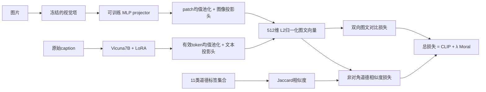

# 图文匹配与道德约束

旧 full 包做的是五维标签 JSON 指令微调。新入口改为图文检索训练：给图片和候选描述分别编码，在同一个 512 维空间里匹配；同时用道德标签约束不同样本间的相似度。旧训练、权重和演示仍可作为历史问答基线。

这是把 MoralCLIP 的训练目标迁移到 LLaVA 组件上，并非论文原始 CLIP 双编码器的完整复现。新检索权重没有做五维 JSON 联合训练，不能用它的检索分数证明问答能力。

## 实际架构



图像路经过视觉塔和 projector，不经过 Vicuna；文本路经过 Vicuna，不看图片。图像路不接收候选 caption，也不把标签输入编码器。可训练参数是语言 LoRA、projector、两路投影头；视觉塔和语言基础权重冻结。没有使用 Qwen 的 Patch Merger。

语言侧 LoRA 学的是 caption 特征对齐，生成头不参与本轮前向或训练，也不计算答案生成损失。若后续要求看图生成道德判断或解释，需要另加生成监督与对应评测。最终架构图见 [PNG](outputs/alignment_architecture.png) 和 [SVG](outputs/alignment_architecture.svg)。

默认不传 `--vision-model` 时保留 LLaVA 原始 ViT-L/14@336（576 patch）。按此前选定的 ViT-B/16 方案，可用普通 OpenAI CLIP ViT-B/16 替换，变为 224 像素、196 patch、新建 768→4096→4096 projector，后者必须训练。不要把换塔后尚未训练的模型当成原始 LLaVA 等价模型。

正式对照建议用 `openai/clip-vit-base-patch16` 初始化，而不是已经在道德数据上训练过的 MoralCLIP checkpoint；后者仅可作为注明来源的额外实验。两组消融必须使用同一视觉初始化。

B/16 已固定到 revision `57c216476eefef5ab752ec549e440a49ae4ae5f3`。`scripts/download_alignment_vision.py` 可下载或 `--verify-only` 核验，权重 SHA256 必须一致；来源 sidecar 会写入训练配置。

## 损失与数据

令归一化图像、文本向量为 u、v，`S[i,j] = u[i]·v[j] / τ`。

- `L_CLIP = (CE(S, diagonal) + CE(S.T, diagonal)) / 2`。
- `Q[i,j] = 2 * Jaccard(M[i], M[j]) - 1`。
- `L_Moral = mean((S[i,j] - Q[i,j])², i != j)`。
- `L = L_CLIP + λ * L_Moral`，默认 λ=0.4，固定 τ=0.07。

论文式3的 `sim` 是除以温度后的相似度，默认 `paper_scaled` 照此计算；目标仍为 [-1,1]，所以道德项可能比 CE 大。日志会单列两项以及加权道德项。`--moral-similarity cosine` 则是使用原始 cosine 的显式变体，不能和默认模式混报。

保留原始图像级划分：训练 2140、验证 134、测试 126 张，每图原有 10 条描述。每个 epoch 每张图取一条描述，固定种子轮换；同批图片 id 不重复。正式 batch64 每轮为33批，`drop_last=True` 略过末尾28张图，所以10轮不保证每张图的十条描述都实际参与训练。道德标签使用 10 个极性标签及 `non-moral`，没有给每张图补公共的 neutral 标签。caption 继承图像标签，这不等同于人工核验的文本标签。

本次数据来自 `moral-llava-full-20261018T080311Z.zip` 恢复出的 `moral-llava/data/raw/SMID_moralclip`。恢复时已按 full 清单逐文件核验 SHA-256，记录见 [恢复报告](outputs/alignment_restore_report.json)；没有另外换数据集。

数据启动时会检查图片解码、跨 split 重复 id、路径和字节 SHA；字节检查不能排除视觉近重复。损失检查实际 batch≥2。梯度累积不会增加对比矩阵中的负例数量：batch=8、accumulation=8，实际仍是 8×8，并非 64×64。

## 运行

训练与评测逐行命令见 [alignment_commands.txt](alignment_commands.txt)，仅推理命令见 [alignment_inference_commands.txt](alignment_inference_commands.txt)。沿用 AutoDL 已有 BF16 LoRA 环境，不需要重新安装或复制 7B 基座。

```bash
cd /root/autodl-tmp/moral-llava
source scripts/activate_autodl.sh
python -m moral_llava.train_alignment --output-dir runs/alignment-smoke --vision-model /root/autodl-tmp/clip-vit-base-patch16 --batch-size 4 --smoke-test
```

烟测只训练两步，在8张验证图上检查前向、反传、保存和检索接口，**不能作为成绩**。每个 output-dir 必须是新目录，以免混入上次实验。

正式匹配基线：同样训练配置，`--moral-weight 0`。道德约束组：`--moral-weight 0.4`。两者默认10轮、真实batch64、AdamW lr=1e-5、weight decay=.01、cosine调度；在 A800 上需以实际显存检查为准。如果 OOM，两组都改成同样的真实batch32，并记录偏离论文batch64。不要用 gradient accumulation 冒充负例数。

每轮用完整 validation 候选池验证，默认按道德标签 MAP 选择；如以同图 R@1 为主要目标，可在两组同时指定 `--selection-metric paired_r1`。checkpoint 存在 `epoch-001` 等目录，`best_checkpoint.json` 指向验证最优轮次。它保存实际训练的语言 adapter、projector、双投影头、温度及处理器，不包含优化器状态，当前不支持断点续训。原始基座和视觉 checkpoint 仍需保留用于重载。

最终只用选中的 checkpoint 在 test 评估一次，不用测试结果调 λ。正式比较时先固定 λ=0 与 0.4；如果需要选择其他 λ，在验证集扫参，并明确额外训练预算。

## 评估和单张图推理

- `same_image_pairing.r_at_1/5/10`：126张测试图查询1260条描述，任一对应描述进入前K即命中。
- `label_relevance.map_i2t`：共享至少一个道德标签算相关，报告 MAP；该口径的 `r_at_*` 兼容字段实际为 Hit@K，不是“检索到的相关项占全部相关项比例”。
- `cross_image_moral_relevance`：先排除查询图自己的全部描述，再报告道德 MAP/Hit，单独注明候选池改变。

结果记录 checkpoint 与数据 manifest SHA、候选 id、图像 id 和数量。不要把 standalone MoralCLIP 的检索分数、旧标签分类 F1 或 smoke 数字记到本次正式实验名下。

```bash
MORAL_CKPT=$(python -c 'import json; print(json.load(open("runs/alignment-moral-b16/best_checkpoint.json"))["checkpoint"])')
python scripts/evaluate_alignment.py --checkpoint "$MORAL_CKPT" --split test --precision bf16 --text-max-length 320 --output outputs/alignment_test_manual.json
python scripts/retrieve_alignment.py --checkpoint "$MORAL_CKPT" --image uploads/user_test_20261018.png --candidate-split test --precision bf16 --device cuda --top-k 5 --text-max-length 320 --output outputs/image_retrieval.json
```

上面的命令自动读取 `best_checkpoint.json` 里的路径。单张图推理默认对测试描述候选库排序；也可以 `--captions-file candidates.txt`，每行一个待比较描述。它只比较候选文本，输出 cosine 及排名，不生成自由回答，也不把 cosine 说成概率。

## 核心文件

- `moral_llava/alignment.py`：两路编码、视觉替换、checkpoint保存与恢复。
- `moral_llava/alignment_data.py`：原始划分、caption轮换与数据检查。
- `moral_llava/alignment_losses.py`：图文对比项与道德约束。
- `moral_llava/train_alignment.py`：训练、梯度检查、验证与checkpoint选择。
- `scripts/evaluate_alignment.py`：实际新权重的固定候选池评估。
- `scripts/retrieve_alignment.py`：给定图片，对候选文本排序。

## 当前验证状态

2026-10-18 已从 full 归档恢复服务器项目，逐文件 hash 核验通过。服务器54项回归检查通过；离线保存修复后，7项模型检查再次通过。真实 LLaVA-7B + 普通 CLIP B/16 在 A800 上以 BF16、实际 batch64 训练两步，四组可训练参数均有非零梯度，峰值分配显存约19.7 GiB。保存后离线重载，已对用户图片在验证描述库中完成top3检索。

上述两步烟测只检查链路，不作为成绩。正式 λ=0/0.4 对照已全部完成：两组均为10轮、330个优化器步，真实batch64，统一 `--text-max-length 320`，完整训练描述最长263 token，未截断。机器可读状态为 `outputs/alignment_experiment_status.json` 中的 PASS；两组独立测试和用户单图检索阶段也均成功执行。

| 方案 | 验证选中 epoch | 测试配对 R@1 | 测试道德 MAP | 测试跨图道德 MAP |
| --- | ---: | ---: | ---: | ---: |
| λ=0 | 8 | 63.49% | 43.48% | 40.64% |
| λ=0.4 | 10 | 55.56% | 44.05% | 41.36% |

这次道德 MAP 上升 0.57 个百分点，跨图道德 MAP 上升 0.71 个百分点，但配对 R@1 下降 7.94 个百分点。当前只能说明固定 λ=0.4 有这种取舍，不能宣称全面提升，也未做多种子显著性检验。若交付重点是配对 R@1，本轮 λ=0 权重表现更好。

详见[正式报告](outputs/alignment_experiment_report.md)、[结果图](outputs/alignment_experiment_results.png)、[比较JSON](outputs/alignment_experiment_comparison.json)。本地只同步运行记录、指标和图，训练权重保存在服务器。

用户上传图片已用 λ=0.4 的正式权重完成检索，见[原始JSON](outputs/alignment_moral_b16_user_retrieval.json)与[单图结果图](outputs/alignment_user_retrieval.png)。当前候选库中的前五条描述与这张图不贴切；该结果不作成功案例，cosine 也不是概率。它未提供单图R@1或MAP，不能据此报告单图准确率。

机器可读验证记录见 `outputs/alignment_validation.json`；训练烟测保存在 `runs/alignment-smoke-b16-batch64`，不与正式权重混用。
