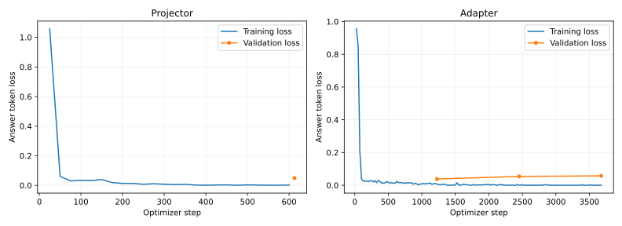

# 数据与评测交付信息表

仓库下载方法见[交付说明](README.md)。数据路径均为仓库内相对路径，权重通过 Git LFS 下载，外部固定基模按各协议准备。此表报告现有材料与本次实际复现结果；接收方专用栏位保留真实状态。

## 评测 code & data

| 字段 | 当前 3.1 极性 TICR |
| --- | --- |
| benchmark 名称／类别 | 项目 SMID 五道德基础条件极性问答，安全／道德对齐评测；协议 `smid-foundation-polarity-v1` |
| 数据路径与获取 | `delivery/polarity-v1/test` 随仓库提供；图像、目标、caption0 和 A/B 分组固定 |
| 评测条数 | 原始 test 126 场景中 87 场景符合极性条件，288 图文任务对、576 问；五维不等支持数，采用五维宏平均 |
| 脚本入口 | `python 3.1/scripts/evaluate_delivery.py --data <test-source-root> --ckpt <adapter-dir> --output <new-results>`；完整命令见 README |
| 模型 | `3.1/models/moralclip-llava-polarity`；LLaVA-1.5-7B + 原始 MoralCLIP ViT-B/16；冻结版本和权重 hash 见模型 README |
| 评测参数 | free greedy，do_sample=false，temperature 不启用，thinking=false，max_new_tokens=16，最大输入含保留生成空间 2048，BF16；不强制输出合法标签 |
| 并发与时间 | 本次新入口完整推理：1 个进程，batch=8，推理含加载约 61.014 秒，评测／计分总计 61.317 秒；具体命令与 UTC 起止时间见 run.json |
| 本课题结果 | TICR 90.2056%，图像准确率 88.9690%，文本准确率 92.3218%，图文同时正确率 85.7482%；均为五维宏平均 |
| 本课题逐条日志 | [576 条真实新推理回答](reports/polarity-live-answers.jsonl)、[metrics](reports/polarity-live-metrics.json)、[run](reports/polarity-live-run.json)、[推理日志](reports/polarity-live-inference.log)、[实际输入](reports/polarity-live-evaluation-data.json) |
| 独立归档复算 | [replay metrics](reports/polarity-replay-metrics.json)、[replay run](reports/polarity-replay-run.json)；复算未计为新模型推理 |
| Intern-S2 基础评分／日志 | 待项目组联测；本仓库未提供该模型的真实评分和回答 |
| 测试独立性说明 | 沿用已多次使用的冻结测试集，不能宣称新的盲测；TICR 需同时查看准确率，恒定输出可能有高一致率 |

| 字段 | 3.1 MoralCLIP R@1 | 3.9 私有图文检索 |
| --- | --- | --- |
| benchmark／类型 | SMID 道德标签检索，安全／道德一致性 | SMID 私有图文对检索保持率，隐私与语义／价值保持 |
| 数据 | 原始公开测试图 126 张，10 caption／图 | 原始 126 图、1260 图文对；私有样本需另行准备 |
| 入口 | `3.1/run_retrieval.py --model <ckpt> --output <result>`；数据默认仓库 test，可显式配置，详见协议 | `3.9/run_evaluation.py --data <original> --private-data <private> --ckpt <model> --output <results>` |
| 参数 | 原始冻结 MoralCLIP、固定词表／候选池；不是生成任务，无 temperature/thinking | batch=32 默认，检索 chunk=128，bootstrap=2000、seed=20261003；图像／文本 epsilon 各 20，不相加声称统一记录隐私 |
| 已发布结果 | 图→文 126/126=100%，文→图 1176/1260=93.33% | 归档值：图→文保持率 91.2698%，文→图 77.0985%，双向几何平均 83.8855% |
| 结果／日志 | `3.1/results/reference/moralclip-r1-bidirectional-20261104`，含矩阵、逐条结果与报告；原独立复现目录保留运行日志 | ZIP 内 `正式测试结果说明.md`；外部私有数据、缓存与完整机器日志未随原 ZIP 上传，本次未完整复测 |
| 时间／并发 | 原冻结运行／复现记录见各目录；本次不重跑模型，不虚填新耗时 | 原 ZIP 缺统一结构化运行时间记录；新入口会记录 worker=1、batch 与 wall time，待资产齐备实测 |
| Intern-S2 | 待项目组联测 | 待项目组确认对生成式基线的评测适配与联测 |

## SFT 数据

| 字段 | 当前极性 SFT | 历史三状态 SFT |
| --- | --- | --- |
| 版本／run_id | `smid-polarity-feishu-v1-20261105` | `smid-legacy-feishu-v1-20261105` |
| 数据路径 | `delivery/polarity-v1/{train,validation,test}`，每个 split 单独 source_root | `delivery/legacy-three-state-v1/{train,validation,test}`，每个 split 单独 source_root |
| 训练／验证／测试条数 | 9806／580／576 | 2138／134／126 |
| 训练有图／无图 | 4903／4903；共享 1381 张图 | 2138／0；2138 张图 |
| 验证有图／无图 | 290／290，共 79 图 | 134／0，共 134 图 |
| 测试有图／无图 | 288／288，共 87 图 | 126／0，共 126 图 |
| 平均轮数／agent | 单轮 user→assistant；不是 agent 数据，无 harness | 同左 |
| 类别分布 | 五个道德维度 × 两模态；逐维度和答案计数见 metadata | 六字段三状态 JSON；完整答案组合分布见 metadata |
| 来源／方法 | SMID 衍生图像与标注；固定 caption0；只对已标注维度生成极性问答；无新模型采集 | SMID 衍生标注转五道德维度 JSON；保留 not_annotated 的原义 |
| 采集模型／CoT | 未使用新采集模型，无 CoT；原 caption 的生成模型信息未获验证 | 无新采集模型，无 CoT |
| 面向的 benchmark | 同一项目冻结 SMID 极性 TICR；MORALISE 不作为本次数据构造目标 | 历史 SMID 五维三状态标注／图文一致性任务 |
| 数据流配置 | [config.json](config.json) + `3.1/scripts/build_delivery.py`，真实导出流程；接收方 workflow 专用配置待对接 | 同一导出流程，任务独立，不与当前极性数据混训 |
| 版权／排除 | 既有版权说明、逐图署名与排除清单；2 个受限训练场景未导出 | 同左，原历史数组含 2140 训练行，公开新交付为 2138 行 |

完整分布、每个 JSONL／manifest 的 SHA-256 见 [dataset-metadata.json](reports/dataset-metadata.json)。六个 source_root 共 13360 条记录；图像因任务／split 的独立交付可能在目录间重复，同一 source_root 内共享引用、只登记一次。

## Token 与长度实算

以下使用**当前 MoralCLIP-LLaVA**保存的 processor 与原训练序列构造函数，包含每图实际展开的 196 个视觉 token、角色前缀、答案和 EOS，按一遍数据统计，不计 batch padding 或 epoch 重复；trainable token 使用 next-token shift 后非 -100 标签计数。所有样本长度 ≤2048，最短监督段 4 tokens。历史三状态数据也按当前 processor 渲染，不能视为历史原视觉塔训练的原始 token 计数。

| 数据／split | 总 token | Trainable token | 长度 min／p50／p95／max |
| --- | ---: | ---: | --- |
| 极性 train | 2387399 | 70496 | 138／302／318／356 |
| 极性 validation | 140930 | 4188 | 144／302／318／318 |
| 极性 test | 139671 | 4136 | 140／302／318／318 |
| 历史三状态 train | 939518 | 97146 | 430／439／445／445 |
| 历史三状态 validation | 58916 | 6120 | 430／441／445／445 |
| 历史三状态 test | 55365 | 5721 | 430／441／445／445 |

原始机器结果与 tokenizer 哈希见 [current-model-token-statistics.json](reports/current-model-token-statistics.json)。复算：

```bash
python 3.1/scripts/training_statistics.py \
  --source-root delivery/polarity-v1/train \
  --processor 3.1/models/moralclip-llava-polarity \
  --output /path/to/current-model-train-stats.json
```

**接收方 Qwen3.5-VL 的总 token、Trainable token 和长度分布：待接收方实算后回填。** 飞书要求“统计数字以接收方校验输出为准”；因此上述当前模型实算没有填入 receiver acceptance 字段，不用 tokenizer 对图像占位符的三个 token 冒充图像展开长度。

## 训练与验证材料

当前模型训练参数完整记录在 [frozen_config.json](../3.1/results/reference/moralclip-llava-polarity-20261104/frozen_config.json)：冻结 MoralCLIP 视觉塔和语言基座，先训练 dense projector 1 epoch，再训练 projector + 语言 LoRA 3 epochs；batch=8，梯度累积=1，BF16，seed=42，max_length=2048；LoRA r=16、alpha=32、dropout=.05。联合阶段语言学习率 2e-5、projector 学习率 1e-4，按验证 loss 选择第 1 epoch 的 checkpoint-1226。本次格式整理没有重新训练模型。

- [SFT 模型与下载说明](../3.1/models/moralclip-llava-polarity/README.md)，adapter SHA-256 为 `318b609354f115162f14de9136005ded3cde31865dda8823559b1e0b79f79e2c`。
- [真实 loss 曲线](reports/historical-training-loss.svg)、[projector 逐点 CSV](reports/projector-loss.csv)、[adapter 逐点 CSV](reports/adapter-loss.csv)，来自已上传 trainer_state，不平滑或编造验证点。
- 训练／选模日志、majority／projector-only／trained 对比、原始逐条回答见 [原实验目录](../3.1/results/reference/moralclip-llava-polarity-20261104/) 与 [analysis.md](../3.1/results/reference/moralclip-llava-polarity-20261104/analysis.md)。

| 基线／模型 | TICR | 图像准确率 | 文本准确率 | 图文同时正确率 |
| --- | ---: | ---: | ---: | ---: |
| 训练集多数类恒定输出 | 100.00% | 58.64% | 58.64% | 58.64% |
| 仅 projector 适配 | 74.37% | 90.61% | 70.63% | 67.81% |
| projector + 语言 LoRA | 90.21% | 88.97% | 92.32% | 85.75% |

均为同一冻结测试的五维宏平均。多数类恒定输出的 balanced accuracy 为 50%，说明不能仅凭 TICR 判断道德分辨能力；这些基线结果不替代 Intern-S2 联测。


