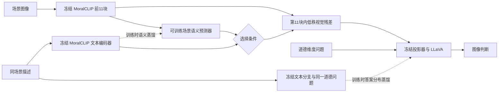

# 同场景文本监督的双模式视觉编码

[项目首页](../README.md) · [已有正式结果](results.md)

本版本修正旧模块只接收道德问题、缺少具体场景语义的问题。条件不再由问题文本生成：有描述时，使用实际同场景描述；没有描述时，使用图像预测的场景语义。新增模块已实现，已完成 CPU 可行性验证；正式7B生成训练和 TICR 提升尚未验证。

## 结构与两种使用方式



| 模式 | 图像编码器的指导条件 | 实际预测需要的输入 | 如何报告 |
| --- | --- | --- | --- |
| 无描述，独立输入评测 | 图像侧预测的512维场景语义 | 图像＋道德问题 | 保持图像／文本独立输入，与原 TICR 基线比较 |
| 有描述，文字辅助 | 冻结 MoralCLIP 编码的实际同场景文字 | 图像＋真实场景描述＋道德问题 | 单独报告文字辅助一致率和准确率，不替代原 TICR |

MoralCLIP 第11块的空间特征先经过一个小型预测器，预测该场景对应的文本语义向量。条件网络据此生成低秩空间的缩放／偏移信号，调节同一层的空间 token；CLS 不调节。描述编码器输出512维，不接收任务问题或标准答案。问题仍作为正常问答输入进入 LLaVA，不再作为视觉模块的条件。

新增可训练参数 **114,080个**，包括场景预测器和视觉残差；冻结原视觉权重、已有投影器、语言模型与既有 LoRA。零初始化残差保持初始输出与直接基线一致。图像预测的是语义向量，不是生成一段可能产生幻觉的文字。

## 训练目标

训练使用同一场景、同一道德维度的图像／文本问答对，仅从训练划分取配套描述和监督答案：

1. 冻结 MoralCLIP 文本编码器，将真实 caption 0 转为场景语义目标；用余弦损失训练图像侧场景预测器。
2. 无描述图像分支使用自身预测的条件，通过原7B解码器的答案与 EOS 交叉熵训练新增模块，保持训练与无描述预测路径一致。
3. 冻结 LLaVA 文本分支作为教师，将同场景文字问答的答案位置分布蒸馏给图像分支。按监督答案平均 NLL 过滤比当前图像分支更差的教师样本；此筛选仅在训练时执行，不宣称等价于教师自由生成正确。
4. 增加实际描述条件下的图像问答监督，使有描述部署时也能使用同一模块；加入视觉残差保持约束。

默认权重：图像答案 CE 为1，文字辅助分支为0.5，教师 KL 为0.2，语义对齐为0.1，残差保持为0.05；KL 温度2。默认训练3轮，rank 32，batch 4、梯度累积2，学习率2e-4。图像训练问答共4,903条。

验证集按**独立输入模式的 TICR**选模，图像准确率、平衡准确率、共同正确率与合法输出率不能退化；第0轮也参与候选。正式测试只在选模锁定后执行。高一致率但判断质量降低的模型不会被当作改进。

## CPU 验证与解释边界

结构检查覆盖真实 Transformers 小型 LLaVA 的前向、反向传播、解码、序列化，以及真实 MoralCLIP 文本权重加载。它们用于判断结构与训练路径是否成立，不产生7B模型的正式 TICR。

真实数据小样本诊断只读取 SMID 的 train／validation：每个维度每类分别选2／1条图像问答，共20／10条，场景互不交叉。使用真实冻结 MoralCLIP 图像与文本权重，缓存第11块输出后释放不用的层，在冻结的最后一块与零样本英文类别提示下训练新增模块5轮。该诊断**不包含 LLaVA 解码器**，其中的分类准确率／图文一致率不能与正式 TICR 对比。

复现命令（使用已安装 CPU PyTorch 的环境）：

```bash
python run_scene_guided_vision.py inspect
python -m unittest discover -s tests -p test_scene_guided_vision.py -v
python scripts/check_scene_guidance_cpu.py \
  --model /path/to/moralclip-base \
  --output results/runs/scene-cpu-new
```

小样本诊断必须使用新的输出目录。原始报告会明确标记 `diagnostic_only=true`、`formal_7b_ticr_available=false`、`test_split_used=false`。CPU 诊断训练的是可行性代理目标，不能将其权重直接作为已完成7B训练的最终模型。

## 本次 CPU 实测结果

测试日期：2026年11月12日。完整机器记录见 [cpu-feasibility.json](../results/scene-guided-vision/cpu-feasibility.json)。实际使用20个训练场景、10个独立验证场景，5轮，耗时84.07秒；没有使用测试集，没有进行7B训练。

| 验证集诊断项 | 训练前零残差模块 | 5轮后，无描述模式 | 5轮后，有描述模式 |
| --- | ---: | ---: | ---: |
| 场景语义预测与真实描述的平均余弦 | −0.0063 | 0.5658 | 0.5658 |
| 代理诊断损失，包含语义对齐 | 0.2531 | 0.1801 | 0.1292 |
| 图像极性分类准确率 | 100% | 100% | 100% |
| 文本极性分类准确率 | 60% | 60% | 60% |
| 代理图文分类一致率 | 60% | 60% | 60% |

有描述模式的余弦项仍统计同一个图像语义预测器，而非将真实文本向量与自身比较；该模式只是选择真实文本向量作为视觉条件。

真实图像上，更换文字条件使视觉特征的最大绝对变化为0.0370；无描述路径在交换监督文字后变化为0。冻结后缀权重逐字节不变，零初始化与原始视觉输出一致。新增11项结构检查与原66项回归检查均通过，包括真实小型 LLaVA 上的反向传播、自由生成和冻结权重检查。真实 MoralCLIP 文本权重也已独立验证完整加载。

**判断：结构、梯度和场景语义学习在 CPU 上成立，尚无一致性提升证据。** 这组零样本 CLIP 代理分类中，图像原本全对而文本只有60%正确；强迫图像照搬错误文字会损害判断质量。因此保留教师筛选和质量约束，后续 GPU 先验证7B小样本及完整验证集，不能将本表60%写成正式 TICR，也不能据语义相似度上升宣称90.20%或91.36%的基线已被超过。

实际 CPU 运行曾因当前2 GiB内存限额中断；最终使用冻结特征缓存、释放前缀和小批量诊断完成。该资源处理不改变图像、描述、划分或监督目标。

## GPU 可用后的操作

当前先完成 CPU 诊断。后续需要完整 LLaVA 基模、MoralCLIP 和已训练直接基线，按[模型获取流程](workflow.md#1-准备环境模型与数据)准备，并设置：

```bash
export BASE_SNAPSHOT=/path/to/llava-1.5-7b-hf
export MORALCLIP_MODEL=/path/to/moralclip-base
python run_scene_guided_vision.py preflight
python run_scene_guided_vision.py smoke --output results/runs/scene-gpu-smoke
python run_scene_guided_vision.py experiment --validation-only \
  --output results/runs/scene-gpu-train
```

`smoke` 仅使用少量训练／验证数据，不生成测试成绩。正式训练先加 `--validation-only`，允许在训练／验证集上研究损失权重，不根据测试成绩反复挑配置。锁定实验目录 `selection.json` 中记录的 checkpoint 后，再执行一次完整独立评测，并额外报告文字辅助模式：

```bash
python - <<'PY'
import json
import subprocess
import sys
from pathlib import Path
selection = json.loads(Path('results/runs/scene-gpu-train/selection.json').read_text())
subprocess.run([
    sys.executable, 'run_scene_guided_vision.py', 'infer',
    '--guidance', selection['checkpoint'],
    '--evaluate-paired', '--output', 'results/runs/scene-gpu-final',
], check=True)
PY
```

主要输出为 `baseline-test.jsonl`、`guided-test.jsonl`、两组指标和 `comparison.json`；有描述模式额外输出 `paired-assisted-test.jsonl`、`paired-assisted-metrics.json`。报告包含场景配对 bootstrap 区间，文字独立分支必须逐条与基线一致。若验证选择第0轮，则如实报告没有验证收益。

有实际用户图像时，可加载同一 checkpoint 做单图预测；有描述加 `--scene-text`，没有描述则省去：

```bash
python run_scene_guided_vision.py predict \
  --guidance /path/to/selected-scene-checkpoint \
  --image /path/to/scene.jpg --task care \
  --scene-text 'A person helps an injured stranger.' \
  --output results/runs/scene-user-prediction
```

## 验收目标

首先在相同精度、模板、batch 和自由生成规则下重跑直接 MoralCLIP–LLaVA 基线；历史同环境参考 TICR 为90.20%。另外报告原视觉塔极性微调模型的历史91.36%，避免将“超过换塔基线”写成“超过所有 Moral-LLaVA 对照”。

`comparison.json` 分别记录是否超过同次直接基线、是否超过历史原视觉塔参考，以及同时保持判断质量的目标是否达成。历史参考不等于新运行的配对对照。训练目标可以提高成功机会，不能预先保证测试 TICR 上升；只有独立输入的正式实测超过基线且准确率不退化，才可把提升写入成果文案。
